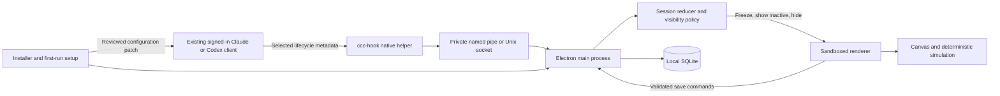

# Claude Country Club Product Architecture

Version 1.2 · October 11, 2026 · Product architecture and acceptance plan

Claude Country Club is a local desktop mini golf companion for the time spent waiting for a coding agent. The game becomes available while an enrolled agent is working, saves its state when the agent stops or needs attention, and returns on the next wait. The product must make coding more pleasant without becoming another interruption.

Build an Electron desktop application, a small native hook helper, and platform-specific installers. Observe supported lifecycle events from the user's existing Claude Code and Codex clients. Country Club never calls a model API, handles subscription credentials, or starts inference to run the game. Windows ships first; macOS shares the application code and is built and tested on hosted Mac infrastructure.

## Repository baseline

The repository was cloned from [ndunl075/Claude-Country-Club](https://github.com/ndunl075/Claude-Country-Club) on October 11, 2026. It initially had no commits or source files. This document specifies the target product; implementation evidence and remaining acceptance gates are tracked separately in PROGRESS.md and docs/COMPATIBILITY.md. Requirements below are not claims that every release gate has passed.

Local checkout:

```text
C:\Users\ndunl\Documents\Codex\2026-10-11\claude-country-club-turns-the-waiting\Claude-Country-Club
```

Implementation now includes the Electron application, Go hook transport, built-in SQLite persistence, nine-hole course library, and native installer configuration. Windows packaged-app tests have passed; real-provider certification, installer lifecycle acceptance, macOS CI execution, signing, and real-Mac tests remain distinct gates. Live provider settings have not been modified.

## Visual direction

Use the user's supplied arcade golf reference for the game: cyan checkerboard surroundings, saturated green turf, pale clean rails, a white ball, black cup, coral flag, and a minimal hole/stroke/pause HUD. Keep the compact waiting-time game focused on the course. Put installation, connections, diagnostics, and preferences in the separate dashboard. Preserve collision geometry and use a consistent camera transform for rendering and aiming; decorative surroundings must never imply playable terrain. Implement and polish UI with GPT-6.1 Sol at High reasoning effort.

## Product boundaries

### Required experience

1. Download a real installer, complete a guided setup, and choose which installed agent clients to connect.
2. Continue using the same signed-in Claude/Codex client and subscription as before.
3. After a short wait, see a small course beside the working application. The course appears without taking keyboard focus.
4. Click the game to aim and play, or ignore it. Keyboard controls become active only after the user focuses the game.
5. When the enrolled agent finishes, is interrupted, fails, or needs input, freeze the round, save it, and tuck the game away.
6. Resume the same round on the next eligible wait. Offer fresh local courses between rounds.

### Scope by release

| Release | Included |
| --- | --- |
| Windows MVP | Electron app, native installer, one validated Claude Code adapter and one validated Codex adapter, manual practice, nine curated holes, save/resume, quiet tray controls |
| Windows stable | Repair/uninstall, safe updates, concurrent sessions, generated courses, accessibility polish, compatibility diagnostics |
| macOS beta | Apple Silicon and Intel packages, Mac IPC and paths, signing/notarization, menu bar behavior, real Mac acceptance tests |
| Later | Additional supported clients, optional data-only course packs, local course editor, Linux after platform testing |

Exclude cloud accounts, cloud saves, multiplayer, leaderboards, advertisements, subscriptions for the game, model-generated courses, and paid API dependencies. Standalone practice remains available when automatic integration is unavailable.

## Noninvasive behavior

The default mode is a compact, ordinary desktop window shown inactive. Do not enable always-on-top, global hotkeys, startup-at-login, sound, notifications, automatic updates, or tracking by default. Remember window position and clamp it into the visible area after display changes. A tray or menu bar icon provides Pause automatic play, Practice, Settings, Diagnostics, and Quit.

Use a 2-second eligibility delay to avoid flashing the course for quick turns. Escape hides the game immediately and suppresses reopening for that wait. Do not reopen it because a tool or subagent event arrived. If the game is not focused, do not intercept input. Do not synthesize clicks, reactivate the editor, or bring another app to the foreground when hiding the game. The user retains control of focus.

Do not inspect source files, terminal output, screen contents, clipboard contents, browser tabs, or chat transcripts. Read only explicitly selected integration configuration and allowlisted hook fields. Never request Accessibility, screen recording, microphone, camera, full-disk access, or administrator privileges for gameplay. Mac package installation may use the OS's normal installation authorization; the application and hook connections run as the logged-in user.

When a client has insufficient lifecycle information, show that integration as limited and use conservative hiding. Never infer completion from a quiet terminal or an idle process. A process that exists is not proof that its agent is working.

## Subscription compatibility

Country Club observes the coding agent; it does not replace or authenticate it. A user signs into Claude Code or Codex through that product's normal flow. Their provider determines access, billing, and usage limits. The game neither adds inference usage nor bypasses subscription limits. Existing agent work may still use the user's plan or API billing configuration independently of Country Club.

No Country Club account, API key, OAuth login, token copying, cookie access, credential storage, or paid model service is needed. Installation never logs a user out, changes their model/provider settings, or attempts to verify a subscription by sending a prompt. A synthetic lifecycle test checks the integration without inference. A real-turn smoke test is a deliberate user action in their existing client.

Compatibility is established per client surface and version. “Works with Codex” must mean a tested local Codex surface; it must not imply that every desktop, IDE, browser, remote, and cloud workflow emits events on this machine. Remote execution requires a separately designed bridge and is outside the first release.

## Technology decisions

| Component | Proposed choice | Reason and tradeoff |
| --- | --- | --- |
| Desktop shell | Electron with TypeScript main process | Consistent Windows/Mac behavior and bundled Chromium; budget for its larger memory and download footprint |
| Interface | React, TypeScript, Vite | Shared settings, onboarding, accessible controls, and game shell |
| Rendering | Canvas 2D with DOM controls | Sufficient for top-down mini golf; no large game engine or network assets |
| Simulation | Pure TypeScript fixed-step physics | Replayable tests and precise pause/resume; collision rules remain deliberately small |
| Persistence | SQLite through bundled node:sqlite in the main process | Transactional saves; verify bundled SQLite in each packaged Electron runtime |
| Hook helper | Small Go executable, ccc-hook | Fast process startup and private local IPC without requiring Python, Node, or Go on user devices |
| Packaging | electron-builder, pinned stable version | Windows NSIS and macOS PKG artifacts; platform-specific installer customization remains necessary |
| Testing | Vitest, Playwright Electron tests, Go tests, native installer harnesses | Cover behavior across process and platform boundaries |
| CI | GitHub Actions on Windows and macOS runners | Build native artifacts on their target OS without the developer owning a Mac |

Pin all build tools and dependency lockfiles. Select supported OS minimums from the chosen Electron release and verified client versions at implementation time; do not hardcode unsupported legacy OS promises. Electron's guidance calls for isolation, sandboxing, IPC validation, and careful navigation controls. Apply those constraints in the main/preload design. [Electron security](https://www.electronjs.org/docs/latest/tutorial/security)

## System structure



The main process owns the database, local IPC server, provider adapters, settings, updates, and native windows. The renderer owns presentation and the simulation but has no Node integration or arbitrary filesystem access. A narrow preload API exposes typed commands and filtered event subscriptions. The helper reads one bounded hook input, strips sensitive fields, sends an event, and exits.

Keep the resident host alive while automatic mode is enabled. Hooks do not launch a game window or cold-start Electron. If the host is absent, hooks exit successfully and drop the event. This keeps coding responsive and prevents an old start event from opening a game much later. Manual app launch starts with all agent states unknown until fresh evidence arrives.

## Agent adapters

### Integration mechanism

Both provider adapters translate lifecycle signals into the internal events defined below. Use user-reviewed command hooks rather than screen scraping or transcript watchers. Codex documents lifecycle hooks and requires trust review for non-managed definitions; manually installed desktop plugins can bundle hooks but have public-directory restrictions. Country Club must respect that trust flow. [Codex hooks](https://learn.chatgpt.com/docs/hooks), [OpenAI plugin packaging](https://developers.openai.com/plugins/build/plugins)

Claude Code documents prompt, tool, permission, notification, and stop hooks. Its Stop event represents a response ending and is distinct from interruption and failure handling. Country Club must validate the installed client's actual events rather than assuming parity with Codex. [Claude Code hooks](https://code.claude.com/docs/en/hooks)

The following is the proposed translation policy, not a drop-in provider configuration:

| Provider signal | Internal interpretation |
| --- | --- |
| UserPromptSubmit | Start a root wait if session identity is usable |
| PreToolUse / PostToolUse | Evidence of ongoing work; may resolve an attention state when correlation is sufficient |
| PermissionRequest | Attention required; freeze and hide without returning an approval decision |
| Claude Notification permission_prompt | Attention fallback where supported |
| Claude PreToolUse AskUserQuestion / ExitPlanMode | Attention required before an answer or plan approval; inspect only the exact tool name |
| Stop | End the observed root response; hide conservatively |
| Codex Interrupt | Interrupted root turn; hide |
| Claude StopFailure where available | Failed response; hide |
| SessionEnd | Close the observed session; hide if selected |
| Subagent signals | Metadata under their parent; never independently open or close the selected root wait |

Stop does not certify that the requested code is correct or that all background work is over. Label it “Agent stopped,” not “Build succeeded.” If another hook continues a turn, fresh activity can make the game eligible again after the delay. A continuation that cannot be detected stays hidden. Questions and unsupported permission paths also require a documented limitation: no adapter may claim perfect attention detection without the corresponding signal.

### Capability and version checks

Each adapter declares supported client/surface versions, start/stop/attention/interrupt capabilities, native turn identity availability, installation method, and fixture version. Store this as a compatibility manifest shipped with the app. Setup identifies the executable via known locations or an explicit file selection and obtains a bounded version response. Do not execute arbitrary programs discovered by recursively scanning the disk.

Unknown versions can use manual mode or an explicitly labeled experimental mode. Managed or read-only configuration is reported with an explanation, not bypassed. Installing hooks does not prove they are trusted or firing: show separate Detected, Installed, Trust required, Connected, Limited, and Disabled states.

### Hook output and time budget

The helper returns exit code 0 with no stdout and no provider decision fields. It never approves, rejects, alters, or extends an agent operation. Test this behavior for every hook type in each supported provider version. All optional failures are silent to the agent and visible only in Country Club diagnostics.

Target a 250 ms hard helper deadline including IPC and a warm p95 below 50 ms. Read at most 256 KiB from stdin; immediately discard prompt text, messages, tool arguments, transcript paths, and descriptions. Send only bounded identity, event type, and correlation fields. Configure explicit short hook timeouts through the adapter rather than relying on provider defaults. Saturated queues drop optional activity events; coding never waits for game startup, rendering, or database writes.

## Local event protocol

Use a user-scoped named pipe on Windows and a Unix domain socket in a private user directory on macOS. The native helper must enforce a pipe ACL restricted to the current user and reject remote pipe clients on Windows; the Mac socket directory uses mode 0700 and its socket mode 0600. Add an installation token stored in an OS-protected local file, excluded from logs. The token is local IPC authorization, not a provider credential. Do not expose a localhost HTTP or WebSocket listener.

Electron may need a small native transport binding to create a Windows pipe with the required ACL; proving that boundary is an early technical spike. Do not assume a default Node pipe has the intended access policy.

```typescript
type AgentEvent = {
  protocolVersion: 1;
  eventId: string;
  provider: 'claude' | 'codex';
  adapterVersion: string;
  sessionKey: string;             // salted hash; no raw workspace path
  turnId?: string;                // only when provided by the client
  rootSessionKey?: string;
  kind: 'start' | 'activity' | 'attention' | 'stop' |
        'interrupted' | 'failed' | 'session-ended';
  sourceTime?: string;            // never sufficient to establish order
};
```

Frame messages with a length prefix and a 16 KiB maximum normalized payload. Authenticate before dispatch, validate the schema, then assign a monotonic host receive sequence and local receipt time. Reject unknown major versions, invalid identities, and impossible sizes. Deduplicate event IDs in a bounded 10-minute cache. Acknowledge queue receipt rather than disk completion. Apply per-session rate limits and coalesce repeated activity.

Native turn IDs take precedence over arrival order. A delayed stop for an older turn must not finish a newer one. When a provider omits turn IDs, maintain a session-local observed generation but do not treat that as proof of source ordering. Conflicting starts/stops or ambiguous concurrent delivery move that session to UNKNOWN and hide the game. Synthetic fixtures and real-client tests must establish which version combinations can support automatic mode reliably.

## Session and window state

Maintain one reducer per root session:

```text
UNKNOWN -> WORKING          on a correlated start
WORKING -> ATTENTION        on permission or input-required evidence
WORKING -> STOPPED          on a matching stop
WORKING -> INTERRUPTED      on interruption
WORKING -> FAILED           on failure
ATTENTION -> WORKING        on sufficient correlated resume/activity evidence
any -> CLOSED              on session end
any -> UNKNOWN             on unrecoverable ambiguity or connection loss
```

A lack of hook traffic is not a completion event. After a configurable long inactivity interval, such as 15 minutes, mark the session UNKNOWN and hide with a local “Status unavailable” explanation. This is a stale-state safeguard, not an inferred success. OS sleep clears eligibility; wake requires fresh evidence or manual selection. Restored disk state never automatically marks an agent WORKING.

The game has a separate state: HIDDEN, ELIGIBILITY_DELAY, VISIBLE, FREEZING, and SUSPENDED. Its own round can remain in progress across any number of agent turns.

```text
eligible = automaticMode
        && selectedRoot.state == WORKING
        && selectedRoot.identityIsReliable
        && !dismissedForThisWait
        && !snoozed
        && !systemSuspended
```

For the MVP, the user chooses a connected root session in the tray or setup. A single enrolled active root can be selected automatically. With several sessions, never guess the user's active editor by reading screens or globally tracking application focus. Preserve the selected session. If it stops while others continue, hide first and require a fresh selection to switch. Independent agents cannot keep a finished task's game open. Expose the selected agent label and active count without prompt content.

## Gameplay and saving

### First release mechanics

Provide nine short, top-down holes across three visual themes. The primary control is drag-to-shoot: press the ball, pull away to set the opposite shot direction and power, then release. Pull distance sets initial speed and caps at the power limit. Do not show angle/power sliders or a separate Putt button. A tap or canceled pull must not fire a shot. Keyboard users focus the course, adjust aim and power with arrow keys and shoot with Space, with an accessible aim announcement. Escape cancels an aim before hiding. Include optional reduced motion, high-contrast outlines, scalable controls, and mute-on-by-default audio.

Model circle balls, line-segment walls, static obstacles, friction zones, and a cup. Defer moving obstacles and complex slopes until saves and collision behavior are stable. Use a fixed simulation step, initially 1/120 second, with capped render catch-up. Collision sweeping or sufficient substeps must prevent the maximum-speed ball from tunneling through thin walls. A ball enters the cup only within a capture radius and below a speed threshold. Out-of-bounds recovery uses a saved safe position with an explicit stroke policy.

### Durable shot lifecycle

Before applying an impulse, persist the shot ID, stroke increment, initial position, impulse, physics version, and simulation tick in a SQLite transaction. Apply the shot only after the main process acknowledges it. Prevent duplicate stroke counts with a unique shot ID. During motion, send small checkpoint snapshots every 250 ms; save again at rest, hole completion, and suspension.

When eligibility ends, disable new shots immediately. Ask the renderer to freeze at a simulation tick, capture ball position/velocity, current aim, hole state, and checkpoint revision, and persist it. Hide after acknowledgement, with a 200 ms UI deadline. If the renderer is hung, hide anyway and recover the latest durable checkpoint. “Exact resume” applies to normal suspension; a crash can roll back to the last acknowledged checkpoint. Never deduct an additional stroke to recover an interrupted shot.

The main process rejects stale revisions, non-finite coordinates, oversized payloads, impossible course identities, and saves from an obsolete renderer epoch. If storage fails, keep the previous valid save, pause shots, and show a local storage error. Do not claim that progress is saved before the transaction commits.

Storage failure evidence includes SQLite page-budget exhaustion (actual SQLITE_FULL), transactional round/history preservation and subsequent successful writes after lifting the limit. Installed-app acceptance also holds an external SQLite write lock, exercises SQLite automatic rollback, verifies paused shots and explicit retry without a phantom stroke, then checks exact final-checkpoint restoration after restart. Rollback cleanup must preserve the original write error when SQLite has already ended the transaction. Physical disk/WAL exhaustion and broader filesystem I/O failures remain separate gates.

Startup inspects a private copy of an existing database family: SQLite can rewrite shared-memory sidecars even on a read-only connection. Only explicit SQLite corruption findings allow the recovery choice; a future schema or ordinary I/O error must not be treated as permission to reset. On an explicit launch, the native recovery dialog defaults to quitting with originals preserved. A confirmed reset moves the original SQLite/WAL/SHM family into a uniquely named local recovery directory before opening fresh storage. A synced marker blocks startup during a partial move and permits retry; conflicting originals/archive files stop for manual review. Connection configuration, provider authentication and unrelated files are outside this transaction. Background/login startup errors quit without a modal. Native packaged acceptance verifies cancel, preserve/start-fresh, original bytes and usable quiet defaults; physical power-loss durability is not proven by those tests.

### Course freshness

Bundle all art, fonts, sound, and the curated course library. After completing a round, rotate through unseen courses before repeating them. Add seeded procedural layouts in a later milestone: generate from vetted templates, maintain minimum corridor clearance, test start-to-cup connectivity with an inflated ball radius, and reject overlaps or unreachable cups. A connectivity check alone does not prove enjoyable shot geometry; use simulation sampling and curated review before expanding the template set.

Bound generation attempts and fall back to a curated hole. Persist the realized course geometry, seed, generator version, and physics version with each round. A later update must not silently regenerate an unfinished course. No local model, paid API, or internet connection is required for variety. Imported course packs, if added, contain validated data and images only; they never execute JavaScript or native code.

## Local storage

Use Electron's application user-data directory under a stable app identity. Keep database backups and integration backups separate from installed binaries so upgrades do not overwrite progress. Set restrictive user permissions and handle symlinks/path traversal in all native filesystem operations.

| Table | Essential fields and invariants |
| --- | --- |
| schema_migrations | version, applied_at; transactional forward migrations |
| settings | key, versioned value; validated defaults |
| rounds | id, status, course_json, content_hash, seed, generator_version, physics_version, current_hole |
| snapshots | round_id, revision, renderer_epoch, tick, validated_state_json; monotonic revisions |
| shots | id, round_id, hole_index, impulse, initial_state, tick; unique shot ID |
| hole_results | round_id, hole_index, strokes, par; unique hole result |
| integrations | provider, executable, version, capabilities, config_patch_id, status |
| config_patches | owned-entry IDs, before/after hashes, backup reference; never provider credentials |

Use WAL mode and a single main-process writer. Persist high-value actions transactionally, bound log growth, and perform backups through SQLite's backup mechanism rather than copying a live database file alone. Keep a pre-migration backup, validate the migrated database, and restore on failure. A downgrade must refuse a newer schema or restore a compatible backup without deleting the newer data.

Export/import versioned progress JSON through explicit file dialogs. Validate imports before replacing state and preserve a rollback copy. A local diagnostic ring buffer contains only event categories, timing, app/client versions, and error codes; retain up to 5 MiB and rotate. Export requires a preview and redacts usernames, paths, session IDs, and local tokens. There is no automatic telemetry.

## Intelligent installer and setup

### Download contract

The primary Windows download is `Claude-Country-Club-Setup-<version>-x64.exe`. Mac downloads are signed, notarized `.pkg` installers for `arm64` and `x64`; a universal package can follow once both architectures are tested. Do not label a portable executable, source ZIP, unpacked `.app`, or update archive as the main installer. Display operating system, architecture, version, file size, publisher, and checksum next to each download, with a manual platform selector.

Use electron-builder's supported NSIS/PKG targets, pin its stable configuration schema, and add custom checks only where its normal installer behavior is insufficient. NSIS is the Windows target; macOS PKG is built with Apple's package tooling and signed as a package. [electron-builder build lifecycle](https://www.electron.build/v26/docs/features/build-lifecycle/), [macOS package targets](https://www.electron.build/v26/docs/mac/)

Bundle Electron, the game, native SQLite module, and native hook helper. Installation and manual practice work offline. No developer tools or provider clients are installed as prerequisites. If an agent client is missing, finish installing the app and explain how to connect it later; do not silently download a coding agent.

### Operating system installer

Windows uses an assisted NSIS flow with a per-user install default, no forced elevation, installation directory selection, optional shortcut, and opt-in launch. Mac uses the system Installer with the narrowest supported destination policy; a standard `/Applications` installation may request normal OS authorization. Neither installer configures the root user's provider clients. User-specific integrations belong exclusively to the signed-in first-run setup.

Preflight checks OS/architecture support, available disk space including temporary staging, destination permissions, existing installation version, and whether Country Club is running. Show actionable failure messages and a diagnostic code. Pause or close only Country Club after saving; never terminate Claude, Codex, editors, terminals, or unrelated processes. Refuse unsupported downgrade paths and preserve a verified previous installation when an upgrade fails.

Support fresh install, upgrade, repair, and uninstall explicitly. Repair restores app-owned binaries and reopens connection diagnostics without resetting saves or rewriting unrelated settings. Install cancellation must remove staged files and leave previous versions usable. Avoid machine-wide services, scheduled tasks, shell-profile edits, PATH changes, firewall exceptions, and hidden startup registration.

### First-run connection wizard

1. Explain what Country Club observes and present Practice without connecting.
2. Detect known installed clients and bounded version information, or let the user select an executable.
3. Read only the intended configuration files and display Supported, Limited, Managed, or Missing for each client.
4. Offer explicit per-client integration toggles. Show exact file paths and a readable patch preview before applying changes.
5. Back up the selected configuration; parse JSON/TOML structurally; merge uniquely identified Country Club entries; validate; write through a temporary file and atomic replacement.
6. Verify the original file hash immediately before replacement. If it changed, recompute the patch rather than overwriting another edit. Do not edit malformed or managed files automatically.
7. Guide any provider-native hook trust review. Never disable the provider's trust checks or use bypass flags.
8. Run synthetic start/attention/stop/save events locally. Separately show whether a real client event has ever arrived.
9. Offer window placement, delay, sound, and login-start preferences with quiet defaults.

Existing hooks remain intact and in their existing order. Do not overwrite an existing notify command or an entire hooks section. Prefer dedicated plugin or include files where the tested client supports them. Quote absolute helper paths according to the provider's platform-specific command parser; test paths containing spaces, Unicode, apostrophes, and shell metacharacters. Never interpolate event content into a shell command.

The wizard is deterministic software, not an AI service. It detects conditions and explains repairs without sending configuration to a server. Store a patch ledger with identifiers and hashes. Roll back failed changes using a structural inverse patch where possible, preserving concurrent user edits. If safe merging is impossible, leave a backup and an exact recovery explanation rather than replacing the entire file.

### Updates and clean removal

Initially distribute signed full installers with a user-triggered Check for updates action. Background checks and unattended installs are off. Defer Mac in-app updates until PKG upgrade behavior is proven; do not assume an update ZIP satisfies the installer requirement. Windows automatic updates can follow after rollback, save migration, and signature verification are tested.

On upgrade, save the game, stop the helper listener, preserve user data, migrate transactionally, and validate packaged native binaries. If a helper definition changes, report that provider trust review may be needed again. Do not silently re-enable integrations the user disabled.

The Windows implementation stages replacement files beside the installation on the same volume, verifies a post-signing SHA-256 manifest, snapshots only fixed Country Club HKCU registration keys, and journals the directory switch. The previous application remains until new registration finishes. A failed promotion restores it; a later installer recovers an unfinalized switch before checking versions. The coordinator never reads provider configuration or saved rounds. See [Windows transaction details and limitations](../installers/windows/README.md) and [current acceptance evidence](ACCEPTANCE.md). Manifest checks on an unsigned preview establish extraction integrity, not publisher authenticity. Physical power-loss, disk-exhaustion and native interactive-cancel validation remain separate gates.

Provide an in-app Remove integrations action before OS uninstall, plus an app-owned cleanup executable capable of reversing the patch ledger. On macOS, do not imply that deleting an `.app` or installing a PKG automatically reverses user hook configuration. Offer a documented cleanup flow and a signed uninstaller tool in the installed product. On Windows, the uninstaller should invoke the same user-scoped cleanup.

Remove only unchanged Country Club-owned entries. Preserve third-party edits, hooks, and provider settings. Keep progress by default and offer explicit deletion. If the cleanup cannot run, the missing/disconnected helper must remain harmless, and diagnostics must explain any leftover entries. Test this failure mode in the providers: a nonexistent command may still produce warnings, so retain a minimal no-op helper temporarily if needed rather than promising silent removal without evidence.

## macOS development without owning a Mac

Develop the shared application and game on Windows. Add macOS-specific interfaces for Unix sockets, configuration paths, menu bar behavior, app lifecycle, package installation, and signing. The GitHub Actions matrix builds the Go helper and verifies bundled SQLite on each target architecture, then packages the app on macOS. GitHub documents hosted Intel and Apple Silicon runners. Pin supported runner labels and revalidate availability when creating CI. [GitHub runner selection](https://docs.github.com/en/actions/how-tos/write-workflows/choose-where-workflows-run/choose-the-runner-for-a-job)

For public Mac distribution, sign the app and embedded binaries with the appropriate Developer ID Application identity, sign the PKG with Developer ID Installer, notarize, and staple the required artifacts. Keep signing credentials only in protected release CI. Apple signing membership and any rented testing infrastructure are distribution expenses, separate from the product's promise of no paid APIs. [Electron code signing](https://www.electronjs.org/docs/latest/tutorial/code-signing)

Hosted CI can validate compilation, package content, signatures, notarization, migrations, and many smoke tests. It does not replace testing window focus, Spaces, display scaling, native Installer dialogs, sleep/wake, and live agent hooks in a normal logged-in Mac desktop. Use a volunteer tester or a rented real Mac session. Do not mark Mac stable until those checks pass on both advertised architectures. A Mac can remain beta while Windows ships.

## Security and resource limits

Create renderer windows with `nodeIntegration: false`, `contextIsolation: true`, and `sandbox: true`; keep `webSecurity` enabled. Load only bundled application resources through a constrained local protocol. Block arbitrary navigation, child windows, remote scripts, and renderer network requests. Allow external documentation links only through a validated URL allowlist and an explicit click. IPC handlers check their sender, schema, round identity, and payload bounds. The preload bridge never exposes raw ipcRenderer, arbitrary file paths, shell execution, or credentials.

Treat courses, configuration, imports, and hook events as untrusted data. Package native helpers outside ASAR where necessary and include them in signing/integrity checks. Disable unnecessary Electron features and fuses where compatible with the chosen tooling. Test supply-chain updates against the packaged product rather than trusting dev-mode behavior.

These are initial engineering budgets to measure, not achieved benchmarks:

| Measurement | Target |
| --- | --- |
| Hidden application CPU | Below 1% average on reference hardware; no continuous animation |
| Total hidden process memory | At most 200 MiB initial budget; measure Electron process tree |
| Visible game | Smooth 60 fps on reference hardware with bounded catch-up |
| Hook helper | Warm p95 under 50 ms, hard deadline 250 ms |
| Show after eligibility delay | Within 250 ms with warm renderer |
| Stop to hidden window | At most 200 ms after event acceptance, even on save trouble |
| Resume accuracy | Same saved course, stroke count, and acknowledged simulation state |
| Gameplay network | Zero app-initiated network requests |

Suspend rendering and audio while hidden; destroy or park the renderer if memory budgets require it, retaining the native session listener. Use event-driven activity rather than frequent process scans. Optional update checks are isolated from gameplay and are the only planned runtime network feature.

Local packaged measurements and their limits are recorded in [PERFORMANCE.md](PERFORMANCE.md). The latest helper and warm lifecycle samples fit the initial latency budgets on the Windows reference machine. Chromium net logging recorded no HTTP/WebSocket URLs through startup and gameplay. The parked memory sum must include the Go helper, which Electron's metrics omit: the default packaged sample is 254.30 MiB and the graphics experiment 208.88 MiB, so the 200 MiB target is still open. These results do not certify all hardware or native Mac behavior.

## Proposed source layout

```text
Claude-Country-Club/
  apps/desktop/
    src/main/          lifecycle, IPC ingress, reducer, SQLite, windows
    src/preload/       typed safe bridge
    src/renderer/      React shell, onboarding, settings, diagnostics
    build/             icons, signing settings, entitlements
  packages/game/       simulation, collisions, input, renderer, replay
  packages/contracts/  event/save/settings schemas and generated types
  packages/courses/    curated holes, generator, validators
  packages/adapters/   Claude and Codex mappings, capability manifests
  native/ccc-hook/     Go helper and platform IPC transport
  installers/
    windows/           NSIS checks and repair/uninstall hooks
    macos/             PKG resources and user-scoped cleanup tool
  tests/
    fixtures/          synthetic provider lifecycle payloads
    integration/       event-to-window and save flows
    installers/        fresh/upgrade/repair/uninstall scenarios
  scripts/             build, package verification, release checks
  docs/                architecture, compatibility, privacy, release runbook
  .github/workflows/   Windows and Mac test/build/release pipelines
```

## Build sequence and completion gates

| Phase | Concrete work | Gate before continuing |
| --- | --- | --- |
| 0 Integration and installer spikes | Validate both providers' hooks, native IPC ACLs, no-output helper behavior, Windows focus behavior, one Mac CI package | A synthetic event reaches a packaged desktop app without inference; real-client start/attention/stop traces exist for candidate versions; PKG/NSIS feasibility proven |
| 1 Shared desktop foundation | Electron security boundary, preload contracts, tray/menu bar, practice screen, database migrations | Packaged app starts offline, no unauthorized network, safe IPC rejection, clean shutdown |
| 2 Reliable single-hole loop | Aim, power, collision, cup, shot transactions, pause/resume | Kill/restart and mid-flight stop preserve correct acknowledged progress and stroke counts |
| 3 Automatic play | Provider mappings, root reducer, delay, dismissal, session selection, stale handling | Real Claude/Codex turns show and hide the game; permissions never auto-approved; unsupported paths labeled |
| 4 Installer and onboarding | NSIS, compatibility detection, config merge/trust guidance, repair and removal | Fresh install, existing hooks, read-only config, cancellation, repair, upgrade, and uninstall pass in clean Windows profiles |
| 5 Complete Windows product | Nine holes, course rotation, accessibility, local diagnostics, bounded generation | End-to-end acceptance and resource budgets pass; signed installer and privacy/compatibility docs ready |
| 6 Mac beta and stable | Native IPC, arm64/x64 packages, signing/notarization, cleanup, real desktop QA | Downloaded PKG installs normally; both advertised architectures pass live hooks, save, focus, sleep/wake, and uninstall checks |
| 7 Maintenance | Opt-in updates, expanded compatibility, course packs/editor | Each addition preserves the offline, noninvasive, and subscription-independent game architecture |

Phases can share infrastructure, but do not polish a large course library before the lifecycle and installer spikes pass. If a provider cannot deliver reliable events on the desired surface, ship a clearly scoped CLI integration or manual mode rather than claiming blanket desktop support.

## Verification and release checklist

Use unit tests for collision boundaries, friction, cup speed, deterministic stepping, stale revisions, reducer transitions, and generation constraints. Replay fixture sequences with duplicate, delayed, missing, malformed, and cross-session events. Include a stop arriving during drag, during a shot transaction, during ball motion, and during renderer startup. Verify one session finishing cannot be masked by another session working.

Run packaged end-to-end tests from event ingress through visibility and SQLite recovery. Include renderer crashes, full disk, locked database, OS sleep, multiple displays, disconnected displays, corrupt saves, version upgrades, and helper absence. Validate that hook failure never changes the coding client's permission or continuation decisions. Developer tests must not require provider credentials or paid inference.

Test installers in clean OS profiles with no developer runtimes, an existing installation, paths with unusual characters, running app instances, offline networking, canceled installation, managed provider settings, and existing third-party hooks. Inspect signed artifacts and checksums. Uninstall must preserve provider authentication and unrelated configuration, and keep saves unless deletion was chosen.

Before release, verify this user story on each advertised client and OS: download installer, install, connect the existing signed-in client, submit a normal task, play a shot, encounter an approval request, return to the client, finish the task, wait again, and resume the saved ball. Repeat with automatic mode disabled and confirm no game opens. Test Mac Installer and Windows installer behavior as shipped, not only unpacked development builds.

Publish only after licensing and original asset provenance are recorded, a license is selected by the repository owner, supported client versions are listed, privacy behavior is documented, and native packages pass signing checks. Country Club branding should make its independent status clear; provider names identify compatibility rather than endorsement.

## Decisions to revisit after the first working build

The working defaults are Electron, Windows first, macOS as a gated release, installer-first distribution, quiet automatic windows, one selected root session, local SQLite saves, and no game account or model API. Validate those defaults through a real packaged vertical slice before widening scope.

Remaining product decisions include visual style, public license, signing budget, initial supported client surfaces, minimum OS versions, and whether the first Mac installer should support a per-user destination. These do not block the shared game foundation. Reliable lifecycle correlation, native IPC permissions, safe configuration merging, and installer rollback do block a production claim and belong in Phase 0 or the relevant release gate.

## Implemented shot-history retention

The current SQLite round_save row remains the authoritative exact checkpoint. The shots journal retains the newest 128 inserted entries within 4 MiB of UTF-8 snapshot payloads. Every successful save prunes older journal entries in the same transaction as the checkpoint and unique initial-shot insert; repeated checkpoints preserve the retained initial impulse. A pruning failure rolls back all three operations. Older installations are brought within these limits on their next successful save. This is journal retention, not a replay archive or a total database-size promise: SQLite can retain freed pages for reuse, and progress/settings, indexes, WAL, and recovery backups are separate. The app does not run an automatic VACUUM or delete recovery archives to enforce this limit.


## Implemented private session identity

Adapter 1.2 uses HMAC-SHA-256 over provider, session ID and cwd with a persistent random 32-byte installation key and a 128-bit output. The main process keeps identity-key in user data and includes it in the private helper connection file. The IPC authorization token rotates separately. Key creation is exclusive and synced; existing malformed, nonregular, linked or nonprivate Unix key files are refused and preserved. Failure disables optional connections, leaving practice available; there is no unsalted fallback. First creation clears legacy saved selection because the new pseudonym is incompatible. Existing hooks continue to reference the same connection path. Key/connection files are local secrets protected by access controls rather than encryption. Optional native turn IDs still pass through unchanged. Native and packaged acceptance establish key separation, stable restart and conservative invalid-key behavior, not anonymity, real-client certification or native Mac support.


## Implemented hook-only connection review

Only exact owned/proposed Country Club hook entries cross into the renderer for review. The main process retains complete input bytes and merged configuration, binds confirmation to the full original file hash and rederived projection, and rechecks the hash immediately before atomic replacement. Unrelated settings and third-party hook groups remain intact. Complete rollback copies remain local and may contain sensitive user settings; the dialog discloses this explicitly. Large valid configuration files no longer inflate renderer confirmation payloads with unrelated settings. This is data minimization, not encryption or a complete privacy audit.

## Implemented native packaging consistency gate

Before producing an installer, query the final bundled helper's bounded build metadata and compare adapter/protocol/schema, identity scheme, target OS and architecture with reviewed expectations. Extract and compare the actual ASAR compatibility manifest bytes as well. Run packaging on matching native runners rather than skipping execution for cross-compiled binaries. Mac PKG extraction verification repeats the probe against the extracted payload. This catches stale or incompatible helper builds; it does not replace behavior tests, code signing or native platform certification.

## Implemented suspend and screen-lock holds

Sleep and screen lock are independent main-process holds. Entering or leaving either invalidates known working sessions, disables practice, cancels pending eligibility, freezes acknowledged progress and hides the window. A resume cannot clear an outstanding screen lock. Explicit dashboard/practice requests recheck holds before and after asynchronous renderer recovery. Lifecycle messages arriving during a hold remain subject to bounded validation/deduplication and turn tombstones, but their sessions are immediately marked unknown and unreliable; they cannot open a window or make a replay eligible after resume/unlock. Reopening requires fresh post-hold lifecycle evidence or explicit practice once all holds have cleared. Packaged emitted-notification acceptance covers these transitions; actual OS sleep/wake and lock delivery on each platform remain release checks.

## Startup lock-state initialization

Register power/lock listeners before storage, renderer creation or other asynchronous startup work. Take one standard Electron system-state snapshot after subscription: locked starts held; active/idle establishes lock knowledge; unknown or a query error disables automatic eligibility until a reliable lock/unlock notification arrives. Do not retain idle duration or poll activity. Explicit practice remains available for unknown state, while a known sleep/lock hold blocks all window showing. The initial explicit show and storage-recovery/error dialogs also honor known holds. This covers startup while already locked and notifications during setup; real platform snapshot/notification behavior remains a native certification gate.

## Display-aware window placement

Choose the valid work area with the greatest positive intersection with saved bounds, falling back to primary when the saved display is absent. Preserve negative coordinates and separate dashboard/companion preferences. Clamp integral size and all edges inside the selected work area; lower native minimums below 520x480 when a smaller area requires it. Invalid preferences/displays use bounded defaults. Register display removal/metrics listeners before asynchronous startup. Repair and persist current bounds on those events without showing or focusing the window; hidden windows remain hidden. Physical monitor/DPI changes and native Mac behavior remain platform acceptance gates.

## Implemented local diagnostic review and export

Settings can prepare an allowlisted JSON report for review before an explicit native save choice. Include only normalized numeric application/client versions, platform/architecture, boolean status, bounded session-state counts and up to 80 timestamped allowlisted error codes. Omit raw messages, paths, identities, configuration, IPC secrets and game state. The main process retains one bounded snapshot under an opaque review ID for five minutes. New reviews invalidate older IDs. Validate before and after the native picker and atomically save the exact reviewed bytes; renderer-supplied report bytes are never accepted. Cancellation writes nothing, successful save consumes the review, and write failures preserve existing output and permit retry. There is no upload. Diagnostics keep the newest 80 entries in memory and restore sanitized local history from the bounded rotating store described below.

## Windowless background startup

The Windows native helper uses Go's GUI-subsystem linker mode, creating no window or console and retaining pipe-based broker/hook input/output. The installer transaction coordinator keeps its existing subsystem. Windows Claude connection previews use the documented exec-form executable plus argument array, bypassing shell tokenization and the broken PowerShell fallback of the previous quoted command string. Existing configurations upgrade only through explicit fresh review/apply. Ownership and native cleanup compare full groups, preserve edited arguments, and detect helper references in wrapper arguments. The packaged shell/lifecycle checks are fixture evidence; actual client schema acceptance and delivery remain release gates.

Background/login launch and known startup holds initialize the tray, storage and native broker without creating a BrowserWindow. Explicit opening or a reliably eligible wait creates the course through the same guarded renderer recovery path. Automatic mode off, held events, held-turn replay and a headless broker failure cannot open the course. Attention arriving during first-use creation cancels automatic show. Existing inactive-show, freeze/save/hide, renderer parking and security policies still apply.

The packaged background-startup regression reproduces one unused window on the earlier payload and passes on the new payload: zero windows through automatic-off native start/stop; explicit practice with an actual saved drag shot; first eligible inactive show with exact restore and another drag shot; attention cancellation; lock/replay refusal and fresh-turn recovery; quiet broker failure with explicitly opened usable local practice. The legacy E2E check was corrected to require a ready broker and zero windows rather than waiting for a hidden window. This change does not establish the 200 MiB parked-memory target or certify real clients/physical lock delivery. Evidence: work/background-startup/before-fix.json and result.json.

## Bounded local diagnostic history

The main process stores only allowlisted codes and normalized timestamps in diagnostics-v1 under its application data directory. Raw messages, identities, source/transcript data, configuration, credentials and game state are excluded before queuing. Four rotating JSON chunks each cap content at 1 MiB and 20,000 records, retaining at most 4 MiB in total; a single exclusive synced write stage reserves another 1 MiB during promotion. A bounded queue retains the newest 256 pending records; overload may drop older pending diagnostics. Startup restores the newest 80 sanitized records for the existing UI/export, using a generic historical message rather than retaining original text. The architecture's 5 MiB log-content ceiling includes the write stage, not filesystem metadata or unrelated files.

Ordinary files are opened with no-follow flags where available, checked for file type/link count/identity and bounded before decoding. A linked directory, linked/oversized/malformed chunk, unexpected file or ambiguous stage disables logging and preserves existing files. A complete valid stage resumes promotion after an interrupted rename; an incomplete stage is preserved for manual recovery rather than guessed. Write failure never pauses golf or recursively logs to the failed store. Normal quit drains pending diagnostics after the gameplay freeze/save, with a 500 ms diagnostic timeout. This is best-effort diagnostic persistence: timeout, termination or physical power loss may lose recent entries. Files request user-private modes on Unix; native Mac behavior remains a release gate. Concurrent adversarial replacement of a same-user directory is not certified. No upload or network request is added.

## Startup readiness and explicit-open recovery

Queue the latest explicit dashboard/practice request until storage and IPC handlers are ready. Renderer creation refuses pre-readiness calls. Register privileged scheme capabilities before app readiness, but defer the bundled-resource protocol handler until immediately before the first BrowserWindow. Register it once per application lifetime; a synchronous registration failure must leave a later explicit open able to retry. This avoids premature default-session initialization and its unused spare renderer. Keep the existing path constraints, CSP and renderer sandbox. Lock/sleep clears queued intent and suppresses the ordinary launch window; unlocking requires a fresh explicit request or eligible new wait. Explicit opens recheck holds, quitting and request freshness after asynchronous renderer creation. A rejected load destroys and clears only its own current window, so a later explicit open retries. Caught open failures leave tray/broker initialization running. Packaged inspector-driven acceptance covers early activation, latest practice intent, startup lock and one injected load failure, each followed by a real settled drag shot. A separate cold-start test checks no windows, webContents or Tab process before touching session/protocol APIs, then injects a registration failure and verifies explicit retry, quiet defaults and usable practice. This does not certify physical OS notifications or signed-in client compatibility, or establish the post-game memory budget.

## Passive Claude error and MCP-input signals

The candidate Claude configuration additionally maps StopFailure to failed and Elicitation to attention. The existing bounded helper passes only lifecycle identity/kind; error details, response text, MCP server names, requested forms and authentication URLs are not decoded into transport or storage. These hooks return no output or decisions. Do not map ElicitationResult directly to resumed work: keep ambiguous no-turn sessions hidden until a fresh start. Configuration is still written only after explicit review; an existing installation needs a new review and provider-native trust decision to add these hooks. Fixture acceptance is distinct from native-client version/schema/delivery certification.


## Windows npm Codex discovery

An explicit Check version now also looks for the native Codex executable in three bounded Windows npm layouts under existing search directories: a nested platform package, a hoisted platform package, or the older bundled vendor directory. Only the current architecture's fixed paths are considered. Direct native candidates retain priority; an explicit selection is never replaced with another candidate. No wrapper is read/executed, JavaScript module loaded, recursive home search performed, or package installation attempted. Other package managers/layouts may still need manual native executable selection. Automatic client launch remains disabled.

Windows version probes use an extended-length native executable path. A267-character fixture path reproduced spawn ENOENT without this form; the same file succeeded with it. Packaged acceptance includes a guaranteed over260-character case, plus all three npm layouts. The actual IPC action launches only --version, with private configuration homes and no inherited API keys; arbitrary output is discarded and fixture provider bytes remain exact. These checks use a native fixture executable and do not certify hook schema, trust, account status or event delivery.

A separate read-only source comparison against this device's npm install changes missing to found and reports Codex0.159.3 using --version only in an isolated home. The earlier0.162.0-alpha.17.2 observation came from a different native executable; version observations identify separate installations and must not be conflated. Evidence: work/client-compatibility/native-npm-discovery.json and work/client-discovery/result.json. certifiedClients remains empty. Local command help did not establish a standalone hook validator; the documented Codex /hooks trust review remains a real-client gate, and trust bypass was not used.

## Pointer and keyboard ownership

A pull owns aiming and firing until release or cancellation. While a pointer pull is active, canvas arrow/Space/Enter input is consumed without changing aim/power or charging a stroke. Idle keyboard controls remain available. Escape cancels the active pull; auto-repeat from the same press cannot subsequently hide the app. A fresh separate Escape press can hide an idle course. Existing lifecycle and pointer-capture cancellation remain unchanged.

The previous packaged payload reproducibly committed a shot when Space/Enter arrived before pointer release, and hid on Escape repeat after its first keydown canceled a pull. Both have dedicated input/save traces at work/input-conflicts/before-fix.json. The corrected packaged acceptance verifies exact unchanged progress before release, unchanged aiming under arrow input, one settled pointer stroke, usable later idle keyboard firing, repeat=true Escape staying visible, a fresh Escape hiding, and real-shot recovery after reopen. Test-only observation can affect timing; browser-dispatched repeat does not certify physical keyboard/OS delivery. These newly proven conflicts do not establish the cause of either historical missed-shot or unexpected second-shot observation. Blur/visibility drag cancellation remains a separate native-input investigation; no speculative blur behavior was changed.

Command: npm run test:input-conflicts with CCC_EXECUTABLE. The regression runs inside installed acceptance and CI retains before/after JSON. UI implementation used GPT-6.1 Sol High; root reviewed the changed handlers and React checklist. That change added no extra listeners, effects, layout work or gameplay simulation changes.

## Interrupted pull cancellation

Subsequent packaged investigation established that course focus loss and native window blur/minimization leave a pull armed until a delivered release. The course now cancels an active pull on canvas blur, window blur, or a visibilitychange with document.hidden. Cancellation clears gesture ownership before restoring initial aim and releasing capture. Idle input remains available, including when automatic display shows the window inactive; focus is never requested by these handlers. Window/document listeners use current setters and are removed on cleanup. This supersedes the earlier pending blur investigation above. UI implementation used GPT-6.1 Sol High.

Run npm run test:focus-interruption with CCC_EXECUTABLE. The harness disables Playwright focus emulation before native blur/minimize tests, checks both BrowserWindow and browser focus state with a second owned blank focus destination and state-based waits, verifies exact saved progress after a canceled release and restore, then settles one fresh shot. A separate hidden-document event fixture proves handler behavior only. Before-fix evidence and the focus-emulation control are retained under work/focus-interruption/. Physical Alt-Tab, outside-window release routing and real macOS delivery remain unverified. These deterministic interruptions do not explain the historical input observations.
